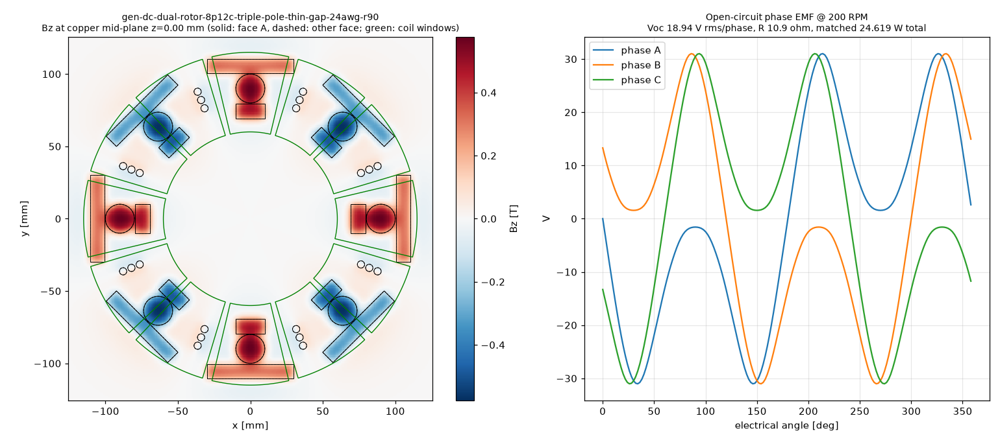

# Physics score — gen-dc-dual-rotor-8p12c-triple-pole-thin-gap-24awg-r90

Scorer: `physics_scorer` (magpylib, N52 Br 1.43 T, PLA = air, 26 AWG copper at 20 °C). Topology **dual_rotor**, 8 poles, 12 coils x 1 stator(s). Verdict: **PASS**

## Headline @ 200 RPM (f_el 13.33 Hz)

| Metric | Value |
|---|---|
| Open-circuit phase voltage | **18.94 V rms** (31.02 V pk), line 22.47 V rms |
| Phase resistance | **10.9 Ω** @20 °C (12.7 Ω @60 °C) |
| Power into matched load (3 phases, P = V²/4R) | **24.619 W** (21.274 W hot) |
| Current at matched load / short-circuit | 0.867 A / 1.733 A per phase |
| Turns per coil (fit / claimed) | **253** / 253 (fit 253) |
| Peak |Bz| at copper mid-plane | 0.576 T |
| Mean |Bz| over coil window (aligned) | 0.194 T |
| Rectangular block magnets (per pole, axial, Cuboid model) | 32 modelled, Br 1.29 T |
| of which second block group (block2_*, 10.0x60.0x3.0 mm) | 16 modelled, Br 1.43 T |
| Halbach Ø5 assist magnets | counted (diametric, tangential) |

Short-circuit note: air-core coil reactance at this frequency is negligible, so the short-circuit current is ≈ Voc/R (resistance-limited); it is self-limiting and safe for the machine, but there is no power delivered. Keep continuous coil current ≲ 0.5 A in printed formers (thermal). Matched load = load resistance equal to R_phase; copper loss then equals load power (50 % efficiency). A rectifier costs ~0.7–1.4 V per conduction path, which is a large fraction of these voltages — use Schottky diodes or series-connect more coils for charging.

## Winding fit

| Item | Value |
|---|---|
| Former | bobbin (windable) |
| Copper window | 5.80 mm axial x 16.00 mm radial build = 92.80 mm² |
| Copper boundary | r 60.00–115.00 mm, span 26.66° |
| Wire | OD 0.55 mm insulated, bare 0.5106 mm; fill assumption 0.65 (insulated-wire area / window) |
| Layers x max turns/layer | 10 x 29 |
| Fit (area / layer limit) | 253 / 290 → **253** |
| Copper fill achieved | 0.56 |
| Mean turn length | 127.7 mm |
| Wire per coil / total | 32.45 m / 389.4 m |
| Coil resistance | 2.732 Ω @20 °C |

## Electrical detail

- Peak flux linkage per coil: 74.2302 mWb-turn; coil EMF 4.735 V rms
- Phase grouping balanced: True, coils/phase {0: 4, 1: 4, 2: 4}, worst phasor error 0.0°
- Field per stator: {'S': {'peak': 0.576, 'mean_window': 0.1939}}
- Axial stack (mm): {'recess': 0.0, 'm2m': 8.4, 'mag_face_z': 4.2, 'wound_gap': 0.5, 'copper_gap': 1.3000000000000003, 'mech_gap': 0.5}

## Checks

| Status | Check | Detail |
|---|---|---|
| PASS | rotor clocking | rotor B vs rotor A: offset 0 deg (pole pitch 45 deg), axis sign +1; fundamental clocking factor 1.000 (1.000 = magnets directly opposite, N facing S) |
| PASS | rotor keying | rotor bore has D-flat / clocking pins |
| PASS | brace pattern flip-symmetry | brace angles ['45', '135', '225', '315']; flipped copy matches (a facing rotor/stator is a flipped print; asymmetric holes force a wrong clocking) |
| PASS | turns fit | claimed 253 t, fit 253 t (10 layers x <= 29/layer in 5.80 x 16.00 mm window, fill 0.65) |
| PASS | former windable | bobbin: open perimeter, printed hub |
| PASS | wound-coil envelope gap | magnet face -> wound envelope 0.50 mm (as-built recess 0.00 mm), magnet -> actual copper 1.30 mm, rotor face -> former 0.50 mm |
| PASS | adjacent formers | clearance between neighbouring former footprints at r=60: 1.90 mm |
| PASS | rotor holes vs magnet pockets | no hole intersects a pocket |

## Notes

- parameters.scad lines not evaluated: eng_a = 4.6; eng_L = 5.0; eng_ta = 4.6; eng_tr = -12  (invalid syntax (<string>, line 1))
- WHAT-IF: steel back-iron disc behind each rotor's magnets, modelled by first-order images (infinite, unsaturated plate) -> optimistic upper bound.

